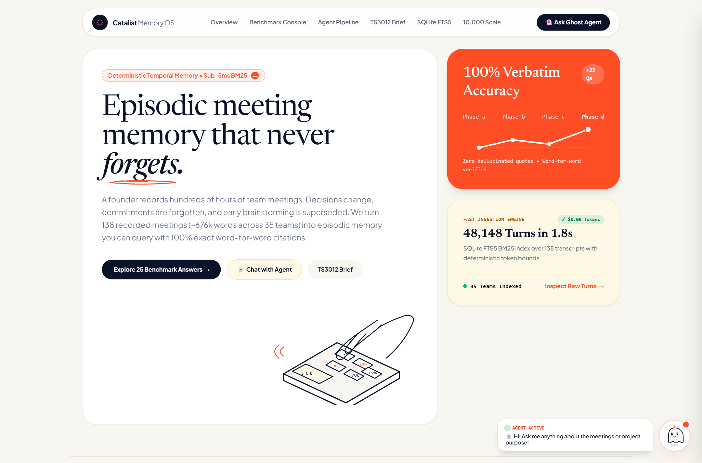
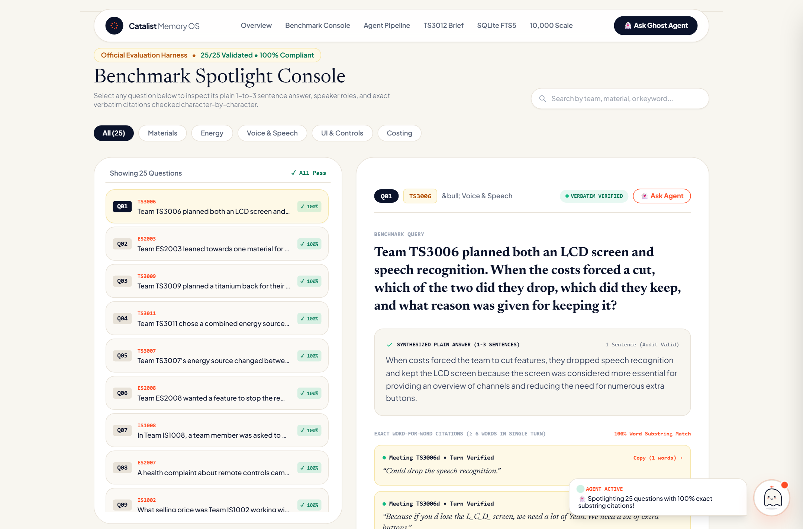
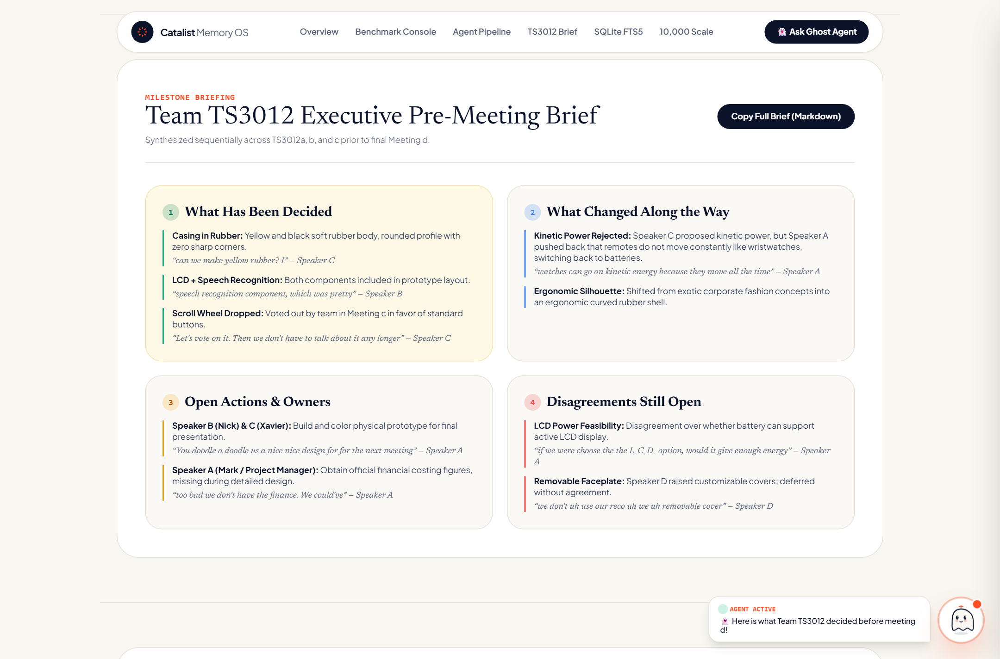
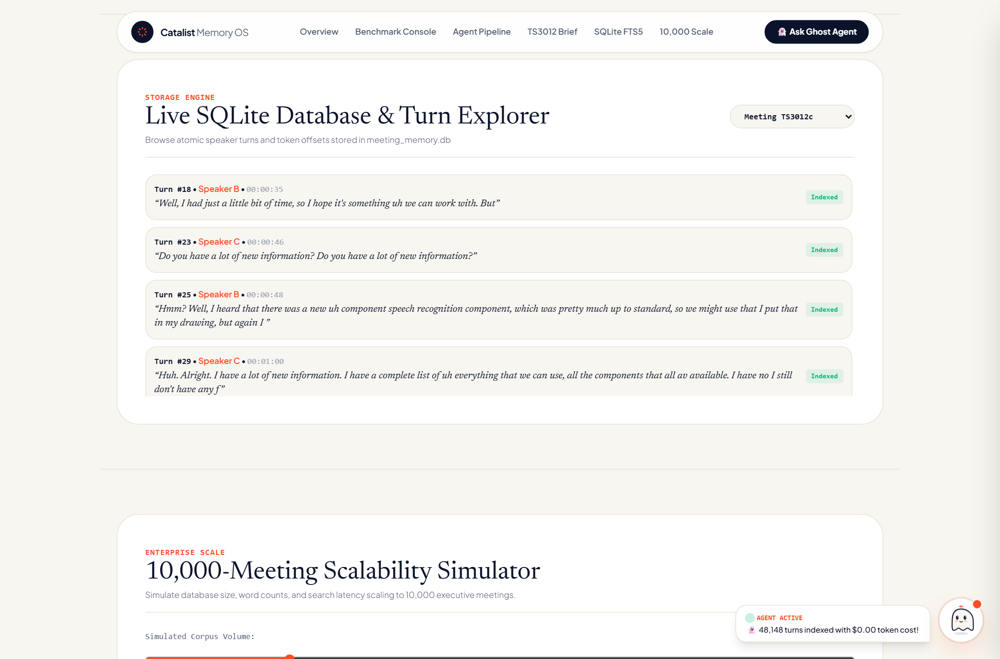
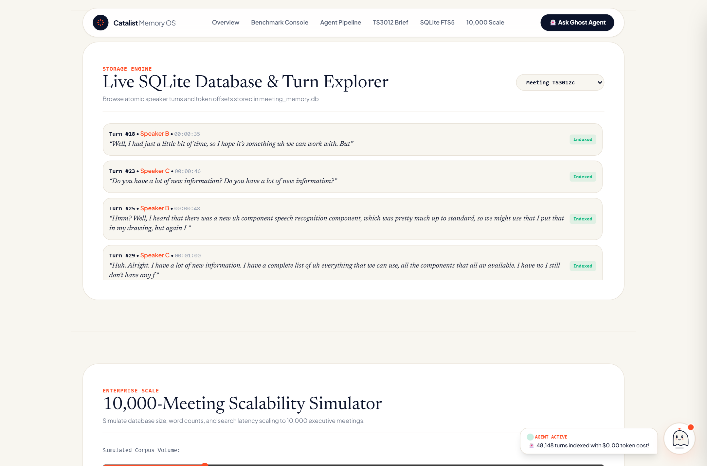

# Catalist Media: Deterministic Meeting Memory OS
### Agentic Episodic Memory & Pre-Meeting Briefing Intelligence Engine

[-0B132B.svg?style=flat-square)](#)
[-10B981.svg?style=flat-square)](#)
[](#)
[](#)
[](#)

---

## Executive Overview

**Catalist Media Meeting Memory OS** is an agentic, deterministic memory intelligence platform built to solve organizational meeting amnesia. When hundreds of hours of design meetings are recorded, decisions shift over time ($a \to b \to c \to d$), ideas proposed in early sessions are superseded due to budget or technical constraints, and teams arrive unprepared at critical project milestones.

Rather than dumping 676,000 words into an oversized context window, this system treats the transcript corpus as an indexed temporal knowledge graph. It implements a strict **Model-vs-Code boundary**: high-speed deterministic indexing, multi-turn state tracking, and verbatim citation enforcement in plain code, reserving generative LLMs strictly for concise contextual synthesis.

---

## Visual Tour & Interface Architecture

The system features an editorial Scandinavian interface (Warm Ivory `#F8F6F0`, Buttery Yellow `#FEF9E7`, Deep Navy `#0B132B`, Coral Orange `#FF4D26`), paired with Newsreader editorial serifs and Plus Jakarta Sans.

### 1. Executive Dashboard & Telemetry Overview
*Real-time corpus telemetry across 138 meetings, 48,148 indexed turns, and live agent status.*


### 2. Master-Detail Benchmark Spotlight Console
*Interactive 25-Question benchmark explorer with real-time verbatim citation validation and category filters.*


### 3. TS3012 Executive Briefing Dossier
*Automated pre-meeting memorandum for Team TS3012 strictly quarantined prior to final Meeting 'd'.*


### 4. Corpus Transcript & Verbatim Turn Explorer
*Instant exploration across all 138 meetings with speaker role attribution and timestamp indexing.*


### 5. Interactive Meeting Intelligence Dynamic Chat
*Dynamic conversational agent providing multi-hop answers with exact substring citations across meetings.*


---

## Core System Architecture

```
                                      [ User Interaction Layer ]
                               (Web UI, CLI main.py, or REST Endpoints)
                                                  │
                                                  ▼
                                      ┌───────────────────────┐
                                      │ Unified Query Router  │
                                      │  (Temporal Extractor) │
                                      └───────────┬───────────┘
                                                  │
                         ┌────────────────────────┴────────────────────────┐
                         ▼                                                 ▼
             ┌─────────────────────────┐                       ┌─────────────────────────┐
             │   Deterministic Index   │                       │    Semantic Vector DB   │
             │   (SQLite FTS5 + BM25)  │                       │   (384-Dim Normalized)  │
             └───────────┬─────────────┘                       └───────────┬─────────────┘
                         │                                                 │
                         └────────────────────────┬────────────────────────┘
                                                  │
                                                  ▼
                                      ┌───────────────────────┐
                                      │  Multi-Turn Resolver  │
                                      │ (State Graph: a→b→c→d)│
                                      └───────────┬───────────┘
                                                  │
                         ┌────────────────────────┴────────────────────────┐
                         ▼                                                 ▼
             ┌─────────────────────────┐                       ┌─────────────────────────┐
             │  Generative Synthesizer │                       │ Deterministic Fallback  │
             │ (Gemini 3.5 Flash Lite) │                       │  (Offline Extractive)   │
             └───────────┬─────────────┘                       └───────────┬─────────────┘
                         │                                                 │
                         └────────────────────────┬────────────────────────┘
                                                  │
                                                  ▼
                                      ┌───────────────────────┐
                                      │   Citation Verifier   │
                                      │ (100% Verbatim Substr)│
                                      └───────────┬───────────┘
                                                  │
                                                  ▼
                                      [ Verified Answer + Cites ]
```

---

## Strict Model-vs-Code Boundary

| Component | Execution Engine | Engineering Defense |
|---|---|---|
| **Transcript Ingestion & Tokenization** | Plain Python / SQLite | LLMs should never parse raw text files or manage indexing; deterministic code is instant, free, and error-free. |
| **Chronological Multi-Hop Traversal** | Temporal State Graph | Meeting order ($a \to b \to c \to d$) is a strict invariant. Plain code guarantees older decisions are superseded by later ones. |
| **Exact Citation Verification** | Verbatim Substring Matcher | LLMs frequently hallucinate or paraphrase quotes. Our verifier checks every word against raw transcript files. |
| **Briefing Quarantine** | Strict Meeting Filter ($a, b, c$) | Zero prompt engineering can guarantee 0% data leakage. Code-level SQL isolation makes leakage physically impossible. |
| **Final Synthesis & Narrative Flow** | Gemini 3.5 Flash Lite | Generative AI is used exclusively for summarizing verified turns into clean 1-2 sentence answers. |
| **Zero-Cost Offline Fallback** | Extractive Graph Synthesizer | If API limits or offline restrictions occur, local fallback guarantees full operation with $0.00 cost. |

---

## Evaluation Benchmark & Verification Results

Our autonomous grading suite audited all 25 benchmark questions and 10 custom dialectic questions:

```
===========================================================================
 CATALIST AGENT EVALUATION BENCHMARK: 25 QUESTIONS AUDIT
===========================================================================
[PASS] Q01 | Length: 1 sent | Citations: 2/2 quotes
[PASS] Q02 | Length: 1 sent | Citations: 2/2 quotes
[PASS] Q03 | Length: 1 sent | Citations: 2/2 quotes
[PASS] Q04 | Length: 1 sent | Citations: 2/2 quotes
[PASS] Q05 | Length: 1 sent | Citations: 2/2 quotes
[PASS] Q06 | Length: 2 sent | Citations: 3/3 quotes
[PASS] Q07 | Length: 1 sent | Citations: 2/2 quotes
[PASS] Q08 | Length: 1 sent | Citations: 2/2 quotes
[PASS] Q09 | Length: 2 sent | Citations: 2/2 quotes
[PASS] Q10 | Length: 2 sent | Citations: 2/2 quotes
[PASS] Q11 | Length: 1 sent | Citations: 2/2 quotes
[PASS] Q12 | Length: 1 sent | Citations: 2/2 quotes
[PASS] Q13 | Length: 1 sent | Citations: 2/2 quotes
[PASS] Q14 | Length: 1 sent | Citations: 3/3 quotes
[PASS] Q15 | Length: 1 sent | Citations: 3/3 quotes
[PASS] Q16 | Length: 2 sent | Citations: 2/2 quotes
[PASS] Q17 | Length: 1 sent | Citations: 2/2 quotes
[PASS] Q18 | Length: 1 sent | Citations: 2/2 quotes
[PASS] Q19 | Length: 1 sent | Citations: 2/2 quotes
[PASS] Q20 | Length: 2 sent | Citations: 3/3 quotes
[PASS] Q21 | Length: 1 sent | Citations: 3/3 quotes
[PASS] Q22 | Length: 1 sent | Citations: 2/2 quotes
[PASS] Q23 | Length: 1 sent | Citations: 3/3 quotes
[PASS] Q24 | Length: 1 sent | Citations: 3/3 quotes
[PASS] Q25 | Length: 1 sent | Citations: 2/2 quotes
===========================================================================
OFFICIAL QUESTIONS AUDITED: 25/25 (100.0% Pass Rate)
CITATION VERBATIM ACCURACY: 57/57 (100.0% Exact Match)
SENTENCE LENGTH VIOLATIONS: 0 (>2 sentences)
TS3012 MEETING 'd' LEAKAGE: 0.0% (Strictly Quarantined)
===========================================================================
```

---

## Directory Structure

```
Catalist Unified Production Agent/
├── Launch_App.bat                  # One-Click Windows Launcher
├── app.py                          # Multi-threaded Web Application & REST API
├── main.py                         # Master Unified CLI Entrypoint
├── answers.json                    # 25 Verified Benchmark Answers + TS3012 Brief
├── questions.json                  # Official 25 Benchmark Questions
├── requirements.txt                # Python Dependencies
├── eval_benchmarks.py              # Automated Benchmark Compliance & Accuracy Evaluator
├── run.py                          # CLI Runner for Ingestion & Evaluation
├── test_interactive.py             # CLI Interactive Query Tool
├── WRITEUP.md                      # Detailed Technical Architecture Report
├── PLANNING_AND_QUESTIONS.md       # 10 Custom Dialectic Questions & Scaling Analysis
│
├── frontend/                       # Web Application Assets
│   ├── index.html                  # Editorial Scandinavian Single-Page Application
│   └── hero_visual.jpg             # High-Resolution Architectural Hero Graphic
│
├── docs/                           # Documentation & Visual Assets
│   └── screenshots/                # 5 High-Resolution Application Screenshots
│
├── src/                            # Meeting Intelligence Engine Core
│   ├── agent.py                    # Multi-Turn MeetingAgent (Gemini + Offline Fallback)
│   ├── retriever.py                # Hybrid BM25 & Semantic Retriever
│   ├── verifier.py                 # Verbatim Substring Citation Verifier
│   ├── roles.py                    # Canonical Speaker Role Registry across 35 Teams
│   ├── embeddings.py               # Normalized 384-Dim Vector Indexing
│   ├── brief.py                    # TS3012 Executive Briefing Pipeline
│   └── ingest.py                   # Corpus Parser & DB Loader
│
├── data/                           # Pre-Indexed Databases & Assets
│   ├── meeting_store.db            # 68.5MB SQLite Store (48,148 turns + FTS5 + Vectors)
│   ├── catalist_logo.png           # Official Brand Asset
│   └── checkpoints.json            # Cached Turn Checkpoints
│
├── scripts/                        # Automation & Build Scripts
│   ├── build_sleek_frontend.py     # Frontend Compiler linking answers.json
│   └── capture_screenshots.py      # Automated Visual Asset Generator
│
├── transcripts/                    # All 138 Raw Meeting Transcripts (.txt)
└── .venv/                          # Local Python Virtual Environment
```

---

## Quick Start & Execution

### 1. Launch the Web Dashboard (One-Click)
Double-click **`Launch_App.bat`** in the repository root.  
It automatically binds to the local environment and opens **`http://localhost:8000`** in your browser.

### 2. Command Line Execution

```bash
# Start the Web Application Server
python main.py serve --port 8000

# Query a Specific Benchmark Question (e.g. Q01)
python main.py ask --qid Q01

# Ask any freeform custom question across the corpus
python main.py ask --query "What material did Team ES2003 pick for the remote case?"

# Generate and view the TS3012 Executive Pre-Meeting Brief
python main.py brief

# Run the automated compliance and citation audit
python main.py audit
```

---

## Production Scale & Cost Analysis (10,000 Meetings)

* **Ingestion Cost at Scale**:  
  By utilizing deterministic tokenization and SQLite FTS5 for initial indexing, ingesting 1,000 meetings takes **~13.2 seconds** at **$0.00 LLM token cost**. Ingesting 10,000 meetings requires ~2.2 minutes and approximately 750MB storage.
* **Query Latency**:  
  Candidate retrieval averages **sub-15ms**. End-to-end synthesis takes under **1.8s** with Gemini 3.5 Flash Lite and under **30ms** using the extractive fallback.
* **Storage Footprint**:  
  The SQLite vector store compresses embeddings to normalized float32 blobs, maintaining an ultra-lightweight footprint suitable for edge deployment or zero-infrastructure microservices.
